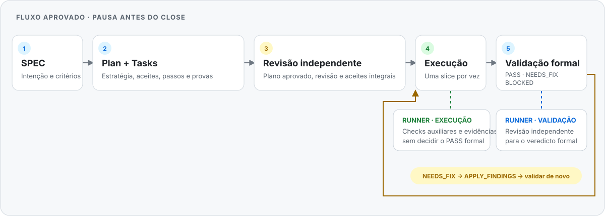

# Sentinel Workflows

O Sentinel reúne skills e agents nativos para **Codex** e **Claude Code**. Ele ajuda equipes de software a transformar um pedido em plano aprovado, implementar mudanças delimitadas e manter evidências para uma validação independente.

O usuário aprova o Plan e as Tasks; o agente principal conduz o trabalho autorizado pelos handoffs atuais, com revisão e validação independentes. Ele continua execução, correções e validação sem pedir um comando a cada etapa e pausa antes do CLOSE, diante de decisão material, permissão ou bloqueio real. Checks de implementação não são aceite formal.

<p align="center">
  
</p>

## Fluxo de trabalho

```text
SPEC → PLAN → REVIEW_PLAN → EXECUTE_SLICE → VALIDATE_SLICE
                                 ↑                 │
                                 └─ APPLY_FINDINGS ┘
```

1. **Defina o trabalho.** `stnl-spec-lifecycle-manager` registra requisitos, critérios de aceite, restrições, riscos e decisões numa SPEC.
2. **Prepare em conjunto.** `stnl-execution-planner` cria o Plan serial e as Tasks operacionais como uma única candidata.
3. **Revise antes de executar.** `stnl-plan-reviewer` revisa Plan e Tasks completos de forma independente, incluindo o checklist inicial e a capacidade das provas, e ativa somente o conteúdo revisado.
4. **Execute uma slice.** `stnl-slice-executor` trabalha dentro da autoridade aprovada. Ele pode delegar os checks da recipe ao runner nativo de validação.
5. **Valide de forma independente.** `stnl-slice-quality-manager` decide a disposição formal dos findings. Somente um `PASS` formal e atual conclui uma slice. `NEEDS_FIX` pode levar a um handoff explícito de `APPLY_FINDINGS` e a outra validação formal.

Cada etapa permanece uma operação separada, mas o agente principal segue os handoffs do trabalho autorizado. Um check bem-sucedido durante a implementação é evidência de apoio; não significa que a slice passou pela validação formal. Ao terminar cada operação, o principal confirma publicação e limpeza, inspeciona o estado atual e segue somente a próxima ação admitida.

O Plan deve usar poucas slices justificadas por dependência, risco ou resultado verificável, e prever desde o início a validação integral. A última slice pode validar a combinação; não é obrigatório criar uma slice extra. PASS local não é conclusão integral. Depois da prova integral e do QA planejado, o agente apresenta os resultados e pede sua decisão antes do CLOSE. RECONCILE, merge e mudança material de escopo não fazem parte dessa continuidade automática.

### Skills de workflow opcionais

- `stnl-spec-roadmap` decompõe requisitos amplos em SPECs candidatas e cobertura de dependências. Não substitui o ciclo de vida nem a autoridade de execução de uma SPEC.
- `stnl-spec-test-runbook` cria um runbook offline para QA ou aceite humano a partir da SPEC, sem depender de execution. Pode ser pedido isoladamente ou incluído no plano aprovado, quando o principal encaminha sua geração sem outro pedido. Gerar o runbook não executa nem valida testes, nem substitui resultados reais de QA.

### Orientação por domínio

O catálogo também inclui sete guias técnicos especializados. Planejamento, revisão, execução e validação consultam o guia principal e apenas as especializações aplicáveis ao escopo aprovado.

| Skill | Aplicação |
| --- | --- |
| `stnl-backend-dotnet` | Backend .NET e C# |
| `stnl-backend-node-typescript` | Backend Node.js e TypeScript |
| `stnl-database-persistence` | Banco de dados, cache, migrações e persistência |
| `stnl-frontend-react-next-angular` | React, Next.js e Angular |
| `stnl-mobile-ios-swift` | iOS e Swift |
| `stnl-security-auth` | Autenticação, autorização, sessões, segredos e limites de confiança |
| `stnl-testing` | Desenho de testes, execução e qualidade das evidências |

A orientação por domínio ajuda a identificar riscos e checks aplicáveis; não acrescenta requisitos nem amplia o escopo aprovado.

## Instalação

### Requisitos

- Node.js 18 ou mais recente.
- Clone local deste repositório.
- Codex CLI e/ou Claude Code instalado e autenticado para o cliente que você pretende usar.

Na raiz do repositório, instale os pacotes dos dois clientes:

```sh
npm run sentinel:install
```

Confira as mudanças planejadas sem gravar arquivos:

```sh
npm run sentinel:install -- --preview
```

Instale ou atualize somente um cliente:

```sh
npm run sentinel:install -- --target codex
npm run sentinel:install -- --target claude
```

O instalador usa módulos nativos do Node; esse comando não instala dependências npm. Depois da instalação, abra uma conversa nova para o cliente descobrir as skills e os agents. O instalador não altera o projeto onde você usa o Sentinel.

### O que a instalação altera

Para cada cliente selecionado, o instalador administra estes diretórios globais:

- Codex: `~/.codex/skills` e `~/.codex/agents`
- Claude Code: `~/.claude/skills` e `~/.claude/agents`

Ele instala 14 skills (sete de workflow e sete de domínio) e dois agents nativos por cliente. Skills e agents Sentinel gerenciados são substituídos quando o conteúdo diverge; entradas Sentinel obsoletas que correspondam às regras de nomes gerenciados podem ser removidas. Skills, agents, projetos e arquivos alheios fora dessas entradas são preservados. Use `--preview` para inspecionar criações, substituições e remoções antes de aplicar.

O instalador planeja e lê o pacote selecionado antes da primeira gravação. Se houver falha de I/O durante a aplicação, ele informa os caminhos aplicados e incompletos; não promete rollback transacional.

## Primeiro uso

1. Inicie uma conversa nova no Codex ou Claude Code.
2. Escolha a operação que corresponde ao handoff atual. Para um trabalho novo, comece com `stnl-spec-lifecycle-manager` e informe o caminho da SPEC e a fonte dos requisitos.
3. Aprove o Plan e as Tasks finais e autorize a execução. O principal coordena uma operação por vez e segue os handoffs; os [templates de prompt por operação](templates/prompts/) continuam disponíveis para pedidos limitados a uma etapa.
4. Para retomar após interrupção, diga “continue” ([exemplo de pedido ao principal](docs/workflow-continue-example.md)). O agente lê os documentos aprovados, inspeciona o estado atual e recupera a operação pendente sem repetir efeitos ou provas já capturadas. Se a autoridade estiver ausente ou ambígua, ele pede somente a decisão necessária. “Continue” não autoriza CLOSE.
5. A pasta da SPEC mantém o material útil para revisão; o rascunho editável usa um único container de planejamento vizinho, e os controles técnicos ficam na área operacional gerenciada. Use os caminhos retornados pelo runtime, não crie cópias concorrentes. Repetir PLAN retoma a única preparação registrada; repetir create não sobrescreve o rascunho. Para corrigir uma captura, revise preserva o histórico e exige nova captura e aprovação. Preparações legadas múltiplas não são apagadas nem escolhidas por inferência.

Exemplo ilustrativo: para adicionar histórico de compras, primeiro defina quem pode consultar quais compras e os critérios de aceite. Conforme o repositório real, o planner pode dividir o trabalho em slices seriais, como acesso a dados e apresentação. Revise o plano completo antes de ativá-lo, execute uma slice selecionada e obtenha um resultado de validação formal separado. Esses artefatos são exemplos; nem todo produto precisa dessas slices.

## Agents

Cada pacote de cliente inclui:

- **`stnl-spec-context-scout`** — faz uma busca delimitada e somente de leitura por contexto do repositório para o fluxo de SPEC.
- **`stnl-validation-runner`** — executa checks selecionados ou faz a revisão formal independente quando uma operação o delega. É somente de leitura; a operação principal é responsável pelas mudanças de implementação e pela disposição dos findings.

O runner faz parte do handoff da operação. Não existe uma etapa manual separada de “rodar testes” nem um fallback silencioso que execute checks delegados no contexto principal. O [guia dos agents](agents/README.md) descreve os launchers de cada cliente, os contratos de entrada e os significados dos resultados.

## Mapa do repositório

| Caminho | Conteúdo |
| --- | --- |
| `skills/workflows/` | Sete skills de workflow, orientações por operação e recursos de runtime |
| `skills/domains/` | Sete guias técnicos de qualidade por domínio |
| `agents/` | Definições de agents nativos para Codex e Claude Code e seu guia |
| `templates/prompts/` | Prompts curtos para operações explícitas |
| `scripts/sentinel-install.mjs` | Instalação global, prévia e seleção de cliente |
| `integrations/` | Helpers de descoberta dos clientes no checkout; não são instalados como etapas de workflow |
| `benchmarks/` | Ferramenta independente para avaliar fluxos em um workspace isolado; não é incluída nos pacotes dos clientes |

Os pacotes dos clientes contêm somente as skills e os agents administrados pelo instalador. Os helpers locais do Codex e as ferramentas de benchmark permanecem no repositório e fora da distribuição instalada.

## Limites e evidências

- A continuidade é feita pelo agente principal, dentro da execução autorizada e dos handoffs admitidos. Os helpers não iniciam agentes em segundo plano. Um pedido de etapa isolada continua isolado, e um plano sintaticamente válido ainda exige aprovação e revisão independente.
- Descoberta nativa e checks do pacote não provam como uma sessão futura de modelo vai se comportar. O uso real de cada cliente e versão é uma observação separada.
- O resultado do runner prova somente os checks ou a revisão que ele de fato realizou. Não garante efeitos externos arbitrários nem substitui o julgamento do mantenedor.
- Não alegamos ganhos de desempenho, custo ou tokens sem medições completas e comparáveis.
- A instalação grava nos diretórios globais Sentinel selecionados. Use a prévia para inspecionar uma atualização; uma falha parcial de I/O não tem rollback automático.

## Checks para mantenedores

`npm test` executa o catálogo auditado em `scripts/test-catalog.json`: scripts de teste em `scripts/`, testes `.test.mjs` das skills de workflow e os testes do seed offline do benchmark. O runner compara os arquivos descobertos com as entradas incluídas e as exclusões justificadas, e falha se surgir um arquivo novo ou se uma decisão do catálogo ficar obsoleta. A única exclusão é `scripts/fixtures/prepared-offline-case.test.mjs`, um fixture de benchmark que é copiado para um checkout gerado e cuja importação relativa não existe no repositório-fonte. Os dois wrappers shell de contratos são classificados em `delegations`, com destino, teste de delegação e justificativa explícitos: cada suite Node roda uma única vez, e `scripts/test-shell-delegation.mjs` verifica os argumentos exatos, a resolução do root com espaços a partir de outro diretório, a propagação de exit não zero e o erro quando Node está ausente. Isso evita repetir as suites completas sem dispensar os contratos dos wrappers. Destino ou teste de delegação ausentes, classificações duplicadas e entradas obsoletas falham antes da execução. Os testes do benchmark usam fixtures controladas; o comando não inicia campanha real, instalação global nem chamada de modelo.

O catálogo offline também executa fixtures sintéticas Python/SQLite e contratos simulados da ponte SQL Server. Para os testes do repositório, é necessário Python 3.9 ou mais recente com SQLite da biblioteca padrão; isso não acrescenta Python aos requisitos das skills instaladas. O gate SQL Server real é separado e explícito (`npm run verify:sqlserver-native`), exige ambiente autorizado e falha se os pré-requisitos estiverem ausentes. `npm test` não inicia Docker, SQL Server, CI ou chamadas de modelo.

Ao terminar os testes, `npm test` roda `scripts/validate.sh --structure-only`, que mantém a verificação de sintaxe, contratos, skills distribuíveis e estrutura do repositório sem repetir os grupos de teste já cobertos pelo catálogo. `scripts/validate.sh` sem argumentos preserva a validação completa existente.

O runner permanece sequencial para limitar memória e preservar o isolamento das fixtures. Cada arquivo produz uma linha `[test-result]` em JSON com status, código de saída e duração em segundos; delegações e fixtures excluídas são identificadas explicitamente, com duração zero porque não repetem a execução. Para salvar o relatório consolidado, use `SENTINEL_TEST_REPORT=/caminho/fora/do/repo/test-results.json npm test` (o diretório pai deve existir). O relatório inclui a validação estrutural, preserva falhas anteriores e só informa sucesso se todas as suites, contratos de delegação e validação estrutural passarem. Não compare tempos de máquinas ou cargas diferentes como se fossem uma medição controlada.

Como referência local, uma execução bem-sucedida do catálogo completo levou cerca de 74 minutos; o tempo varia com a máquina e os casos do benchmark offline, portanto esse número não é uma garantia de duração.

Para rodar checks específicos durante uma alteração, use os comandos pertinentes à área. Exemplos:

```sh
node --test scripts/test-sentinel-install.mjs
node scripts/check-contracts.mjs repository --root .
node scripts/check-contracts.mjs validation-runner --root agents
node scripts/check-distributable-skills.mjs skills/workflows/stnl-execution-planner skills/domains/stnl-backend-node-typescript
```

Esses comandos cobrem contratos diferentes; passar um deles não significa que toda a suíte do repositório ou o comportamento nativo dos clientes foi testado.
